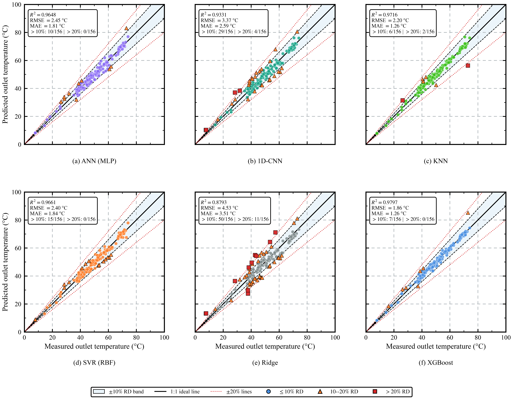
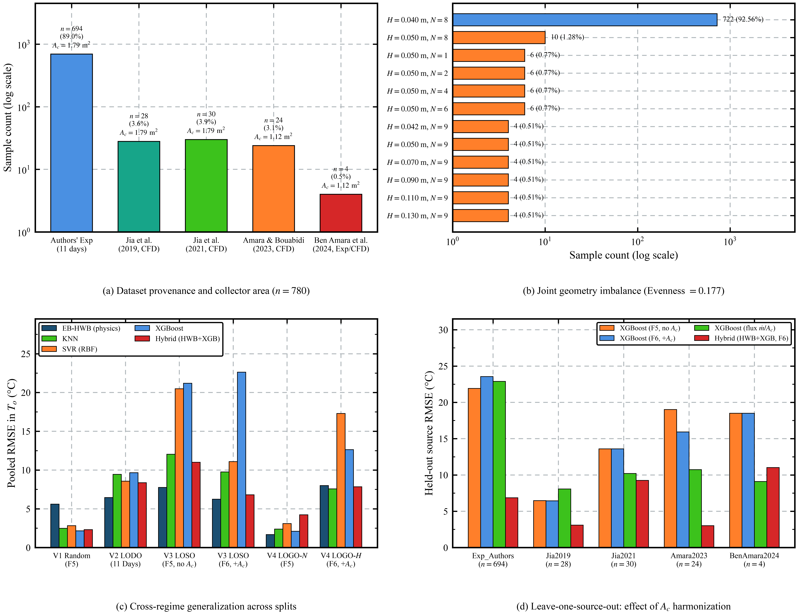
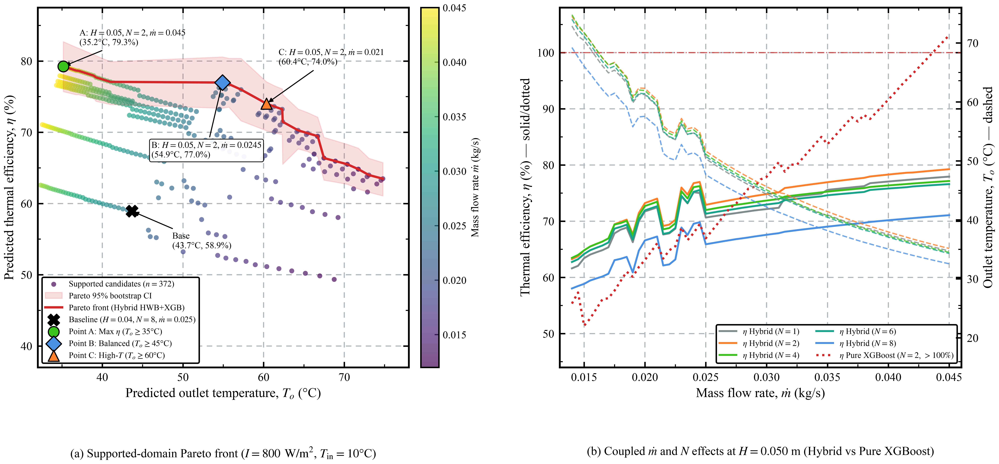

# Machine Learning-Based Modelling for Performance Prediction of a Spiral Solar Air Heater (SSAH)

Reproducible dataset, leakage-free multi-regime benchmark suite, physical/SHAP/uncertainty diagnostics, supported-domain Pareto optimization, and publication-ready figure generation scripts for **Spiral Solar Air Heater (SSAH)** outlet air temperature and thermal performance modelling.

---

## Repository Structure

```text
ssah-ml-modeling/
├── data/
│   ├── raw/
│   │   └── ssah_raw_dataset.xls      # Original compiled workbook (Sheets 1–3)
│   ├── ssah_dataset_clean.csv        # Curated 780-row dataset with provenance & physical quantities
│   └── provenance_summary.csv        # Source-level summary statistics
├── scripts/
│   ├── 01_prepare_dataset.py         # Parsing, provenance mapping, angle alignment, deduplication & audit
│   ├── 02_run_experiments.py         # 11 models across 4 validation regimes (V1–V4), paired tests & timing
│   ├── 03_diagnostics_shap_opt.py    # TreeSHAP, incidence-angle check, uncertainty, 1D-CNN ablation & Pareto
│   ├── 04_generate_figures.py        # Publication figures (Figs. 3–10 in PNG/PDF/SVG + standalone panels)
│   └── sci_style.py                  # Shared journal plotting style helpers
├── results/
│   ├── benchmark_summary.csv         # Summary metrics across all 11 models and validation regimes
│   ├── data_audit.json               # Data distribution, KS/MW tests & geometry imbalance audit
│   ├── experiment_results.json       # Full CV metrics, hyperparameters, paired tests & timing benchmarks
│   ├── diagnostics_results.json      # SHAP, incidence angle, Kline-McClintock + MC, ablation & Pareto stats
│   ├── pareto_front_I800_Tin10.csv   # Supported-domain Pareto front points
│   ├── pareto_candidates_I800_Tin10.csv
│   ├── incidence_angle_lodo_residuals.csv
│   ├── shap_arrays.npz / extrapolation_sweeps.npz
│   ├── v1_* / v2_* / v3_* / v4_*.csv # Saved out-of-fold / test predictions
│   └── figures/                      # Composite Figs. 3–10 (600-DPI PNG + PDF)
├── requirements.txt                  # Exact Python 3.12 dependency versions
└── LICENSE                           # MIT License
```

---

## Curated Dataset Overview

`data/ssah_dataset_clean.csv` contains **780 unique curated records** (1 exact duplicate removed from 781 raw rows) spanning **5 sources** (694 experimental + 86 literature numerical/experimental points):

| Source ID | Citation / Origin | Type | Samples ($n$) | Share (%) | Absorber Area $A_c$ ($\mathrm{m}^2$) | Channel Height $H$ (m) | Baffles $N$ |
|---|---|---|---:|---:|---:|---|---|
| `Exp_Authors` | Authors' experimental campaign (11 test days, Jan 23 – Mar 12; 693 rows aligned with solar incidence angle $\theta$) | Experimental | 694 | 88.97% | 1.7949 | 0.04 | 8 |
| `Jia2019` | Jia et al. (2019), *Chem. Ind. Eng. Prog.* 38(2): 819–825 | Numerical (CFD) | 28 | 3.59% | 1.7949 | 0.04 | 8 |
| `Jia2021` | Jia et al. (2021), *Sol. Energy* 225: 969–977 | Numerical (CFD) | 30 | 3.85% | 1.7949 | 0.05 | 1, 2, 4, 6, 8 |
| `Amara2023` | Amara & Bouabidi (2023), *J. Build. Eng.* 65: 105662 | Numerical (3D CFD) | 24 | 3.08% | 1.1250 | 0.042, 0.05, 0.07, 0.09, 0.11, 0.13 | 9 |
| `BenAmara2024` | Ben Amara et al. (2024), *J. Sol. Energy Eng.* 146(3): 031007 | Experimental/CFD | 4 | 0.51% | 1.1250 | 0.05 | 8 |

---

## Key Multi-Regime Benchmark Results

All 11 models (4 physical/linear baselines, 6 ML models, and 1 physics-residual hybrid model `Hybrid_HWB_XGB`) are evaluated without data leakage across:
- **V1**: 10-repeat nested 80:20 random split (`F5` & `F6_area`)
- **V2**: Leave-One-Date-Out CV across the 11 experimental test days (`LODO`)
- **V3**: Leave-One-Source-Out CV across all 5 sources (`LOSO` on `F5`, `F6_area`, `F5_flux`)
- **V4**: Leave-One-Geometry-Out CV (`LOGO_N` & `LOGO_H`)

Summary from [`results/benchmark_summary.csv`](results/benchmark_summary.csv):

| Model | V1 $R^2$ | V1 RMSE (°C) | V1 MAE (°C) | LODO RMSE (°C) | LOSO `F6` RMSE (°C) | `LOGO_N` RMSE (°C) | `LOGO_H` (`F6`) RMSE (°C) | Inference ($\mu\mathrm{s}$/sample) |
|---|---:|---:|---:|---:|---:|---:|---:|---:|
| `Persistence` | -6.6131 | 38.1935 | 36.8170 | 38.0112 | 37.9500 | 42.9522 | 34.7457 | 0.00 |
| `Linear_dT` | 0.8821 | 4.7615 | 3.5476 | 4.7898 | 7.6618 | 7.4513 | 29.5381 | 0.42 |
| `EB_Simple` | 0.7398 | 7.0344 | 5.5556 | 6.1342 | 6.1865 | 8.5346 | 7.2355 | 0.02 |
| `EB_HWB` | 0.8360 | 5.6004 | 4.3350 | 6.4536 | 6.2494 | 1.6799 | 8.0027 | 0.07 |
| `Ridge` | 0.8820 | 4.7639 | 3.5524 | 4.7918 | 7.4831 | 7.2776 | 29.0635 | 0.41 |
| `SVR` | 0.9585 | 2.8290 | 2.0339 | 8.5714 | 11.0837 | 3.0965 | 17.3055 | 6.02 |
| `KNN` | 0.9675 | 2.4876 | 1.4310 | 9.4455 | 9.7594 | 2.3872 | 7.5760 | 2.03 |
| `XGBoost` | **0.9758** | **2.1557** | 1.4363 | 9.6620 | 22.6265 | 2.1079 | 12.6301 | 2.11 |
| `ANN` | 0.9565 | 2.8655 | 1.9500 | 11.7843 | 23.4196 | 5.0133 | 77.0417 | 0.73 |
| `1D-CNN` | 0.9240 | 3.8154 | 2.7678 | 5.8688 | 25.7468 | 4.6944 | 20.5751 | 2.09 |
| `Hybrid_HWB_XGB` | 0.9714 | 2.3186 | **1.3540** | 8.3655 | **6.8136** | 4.2370 | 7.8501 | 2.15 |

---

## Quick Start & Full Reproduction

### 1. Environment Setup (Python 3.12)

```bash
python3 -m venv .venv
source .venv/bin/activate
pip install -r requirements.txt
```

### 2. Run the Full Pipeline

```bash
# Step 1: Parse raw workbook, align solar incidence angles, deduplicate & audit
python scripts/01_prepare_dataset.py

# Step 2: Run 11-model leakage-free evaluation across V1–V4 + statistical & timing benchmarks
python scripts/02_run_experiments.py

# Step 3: Run SHAP, incidence-angle, uncertainty propagation, 1D-CNN ablation & Pareto optimization
python scripts/03_diagnostics_shap_opt.py

# Step 4: Regenerate all 8 composite figures (PNG/PDF/SVG) and 26 standalone sub-panels
python scripts/04_generate_figures.py
```

*(Running `scripts/04_generate_figures.py` also outputs `.svg` files and 26 standalone single panels inside `results/figures/panels/`.)*

---

## Key Figures Preview

| Parity Plots (Fig. 3) | Generalization & Data Audit (Fig. 7) |
|---|---|
|  |  |

| Supported-Domain Pareto Optimization (Fig. 10) |
|---|
|  |

---

## License

This project is released under the [MIT License](LICENSE).
